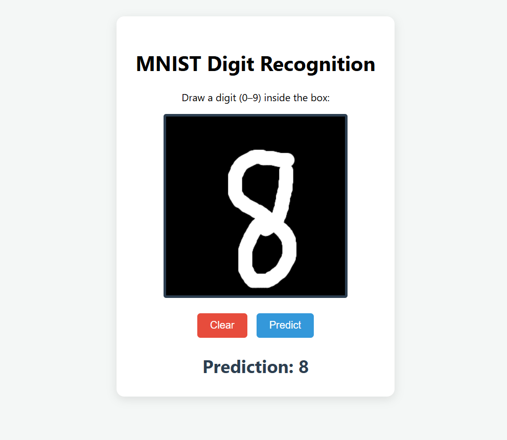

# Neural Networks!!!

i am a beginner to the ai world and am going to be learning about it from scratch. this is my implementation of the MNIST neural network model. This for now is a simple feedforward model. I hope to go into more depth with this and reach CNNs the state of the art model for this challenge and learn about it in the process. This journey has been a lot of fun and heache inducing too 

### the dataset

The Modified National Institute of Standards and Technology (MNIST) database is widely regarded as the "Hello World" benchmark of machine learning and computer vision, specifically designed for training and evaluating pattern recognition systems. Compiled from NIST's original datasets, MNIST comprises 70,000 grayscale images of handwritten digits (0 through 9), standardized to a 28×28 pixel grid, centered, and cleanly normalized. The collection is partitioned into 60,000 training images and 10,000 testing images. Because of its low computational overhead, uniform formatting, and well-defined structure, it serves as the foundational proving ground for verifying neural network architectures—ranging from simple multi-layer perceptrons to advanced convolutional neural networks (CNNs)—before scaling them to complex, real-world data tasks.

### demonstration:

demo link: https://neuralnetworks.duckdns.org/

